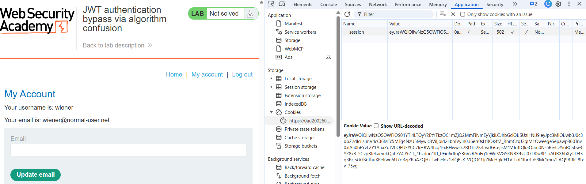

# JWT 1

---

### **JWT authentication bypass via algorithm confusion - Expert**

---

#### Description:

This lab uses a JWT-based mechanism for handling sessions. It uses a robust RSA key pair to sign and verify tokens. However, due to implementation flaws, this mechanism is vulnerable to algorithm confusion attacks.

To solve the lab, first obtain the server's public key. This is exposed via a standard endpoint. Use this key to sign a modified session token that gives you access to the admin panel at `/admin`, then delete the user `carlos`.

You can log in to your own account using the following credentials: `wiener:peter` 

---

#### PART I: Lab Enumeration

- After accessing the lab, I browse around and see some posts. But there’s nothing to do with them since the objective is to forge the JWT.
- So I log in with the given credentials and obtain the JWT from the `Cookies` tab.
    
    
    
- Then I use a `Caido plugin` called `JWT Analyzer` to decode the token. I can see that the `alg` is `RS256` and the `sub` is my `username`.
    
    
    
- To access the admin panel at the `/admin` endpoint, I must be the `administrator` .
    
    
    
- That means I have to change the `sub` claim in my token to `administrator` . Then re-sign the token with the `RSA private key`, which I don’t have.
- This is where `Algorithm confusion` comes in.

---

#### PART II: Explanation

- `Algorithm confusion` occurs when a server supports JWT verification using multiple algorithms, both asymmetric (RS256,…), and symmetric (HS256,…). The server’s intended signing algorithm is asymmetric (RS256), but the verification logic does not enforce this. It still reads the `alg` value from the token’s own header to decide how to verify the signature, rather than enforcing a fixed algorithm server-side.
- Look at this pseudocode:
    
    ```
    function verify(token, secretOrPublicKey){
        algorithm = token.getAlgHeader();
        if(algorithm == "RS256"){
            // Use the provided key as an RSA public key
        } else if (algorithm == "HS256"){
            // Use the provided key as an HMAC secret key
        }
    }
    ```
    
    - The `verify` function uses the same `secretOrPublicKey` parameter for both algorithm branches, but interprets it differently depending on the `alg` value read from the token.
    - When `alg` is RS256 (asymmetric), the provided key is treated as an `RSA public key`and used to verify a signature generated with the corresponding private key.
    - When `alg` is HS256 (symmetric), the same parameter is instead treated as an `HMAC secret key`, used to both generate and verify the signature.
    - Since the application is intended to use asymmetric verification (RS256), the `RSA public key` is not considered sensitive and is expected to be exposed via a JWKS endpoint, as public keys are safe to disclose under RS256.
- This creates the exploitable condition. A value that is only meant to be used as a public verification key can be repurposed as a `private HMAC secret` simply by changing the `alg` header, because the function has no logic preventing that reinterpretation.
- In simple words, I only need to obtain the `RSA public key`, and this game is over.
- By accessing the standard endpoint `/jwks.json`, I can easily obtain the public key.
    
    
    

---

#### PART III: Exploitation

- With everything settled, I go back to my Caido and change the `sub`  to `administrator`. Because the `payload` has changed, the signature is no longer valid and I need to re-sign the token.
    
    
    
- The server might store its public key in a different format, so I need to match that format before signing the token. There’s a hint that the public key is stored as an `X.509 PEM` file.
    
    
    
- Therefore, I use an online converter and pass in the JWK found above (only the {...} part) to get the PEM. (Notice that there’s a newline at the bottom.)
    
    
    
- Next, I sign the token with the HS256 algorithm and use the PEM above as the `HMAC secret`.
    
    
    
- Here’s the new token.
    
    
    
- I replace the old token in the `Cookies` tab with the new one, then refresh the page and see the `Admin panel` appear in the UI.
    
    
    
- Finally, I access it.
    
    
    
- And delete `carlos` to solve the lab.
    
    
    

---

#### PART IV: Root Cause & Remediation

- **Root Cause**
    - The server’s JWT verification logic uses a single generic function that reads the `alg` value directly from the token’s own header to decide how to interpret the provided key, rather than enforcing a fixed, server-side expected algorithm per key.
    - The same key parameter is reused across two fundamentally incompatible security models: under RS256 it is parsed as an asymmetric RSA public key, used to verify a signature generated with a corresponding private key held only by the server; under HS256, the identical parameter is instead treated as raw bytes for a symmetric HMAC secret, which must remain confidential because anyone who knows it can sign a valid token.
    - This design conflates “a key safe to expose” (RSA public key, since only the private key signs) with “a key that must never be exposed” (HMAC secret, since knowing it is sufficient to both sign and verify). The verification function has no logic to detect or reject this conflation.
    - Because the application’s intended default is RS256, the RSA public key is treated as non-sensitive by design and is deliberately exposed via the `/jwks.json` endpoint — a standard, documented practice for RS256 key distribution. The vulnerability surfaces the moment that same, intentionally public value is reinterpreted as a private secret, which happens purely based on a header field the client fully controls.
    - No cryptographic primitive is broken here — RSA and HMAC-SHA256 both function correctly as designed. The flaw is architectural: the server fails to pin the algorithm to the key’s type/purpose, allowing a client-controlled downgrade from an asymmetric trust model to a symmetric one using key material that was never meant to satisfy symmetric confidentiality requirements.
    - Exploitation required no private key, no brute-forcing, and no tampering with anything the server considered sensitive — only reading a publicly exposed endpoint and switching one header value.
- **Remediation**
    - Enforce a single expected algorithm per key (or per `kid`) at verification time, server-side, and reject any token whose `alg` header does not match that expectation. The algorithm must never be derived from the token being verified.
    - Use algorithm-specific verification paths/libraries rather than one generic function that branches on client-supplied input. This structurally prevents a public key object from ever being passed into an HMAC verification call.
    - If multiple algorithms must be supported (e.g. key rotation, multi-tenant setups), maintain an explicit server-side allowlist mapping each `kid` to its expected algorithm and key type, rather than trusting the token’s declaration.
    - Ensure that the JWT library in use has protections against algorithm confusion enabled. Many current libraries (e.g., PyJWT ≥ 2.x) reject passing a PEM-formatted or asymmetric key into an HMAC context by default. Verify that this protection is active and has not been bypassed by custom key-handling code.
