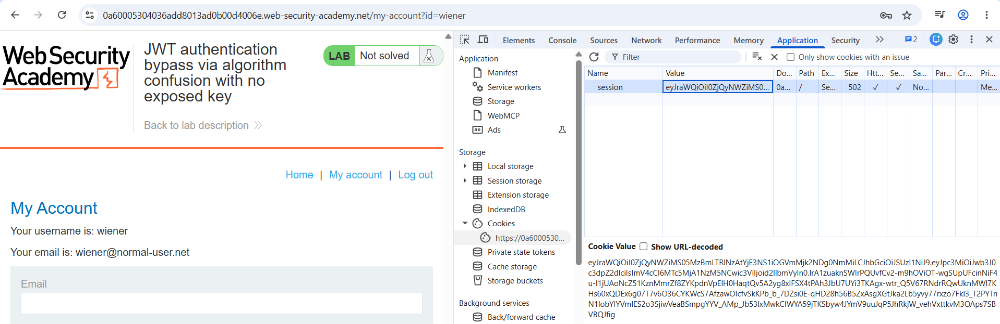

# JWT 2

---

### **JWT authentication bypass via algorithm confusion with no exposed key - Expert**

---

#### Description:

This lab uses a JWT-based mechanism for handling sessions. It uses a robust RSA key pair to sign and verify tokens. However, due to implementation flaws, this mechanism is vulnerable to algorithm confusion attacks.

To solve the lab, first obtain the server's public key. Use this key to sign a modified session token that gives you access to the admin panel at `/admin`, then delete the user `carlos`.

You can log in to your own account using the following credentials: `wiener:peter` 

---

#### PART I: Core Idea

- Just like the previous lab, I still need to forge the JWT. The only difference is that this time I don’t have the public key.
- Concept:
    - An `RSA public key` is fundamentally just a pair of numbers, `(n, e)` - the modulus and the public exponent - and signature verification is a mathematical equation:
        
        ```
        signature^e mod n = pad(hash(message))
        ```
        
    - Even when the server never discloses its public key through any endpoint, it still leaks `n` indirectly every time it issues a valid signature, because `n` is a fixed parameter embedded in every verification equation the key pair produces.
    - If I can obtain two valid `(message, signature)` pairs signed by the same private key (by logging in twice and capturing two separate RS256 tokens), I obtain two equations that share the same unknown `n`.
    - Since `signature^e mod n ≈ pad(hash(message))` for both tokens, the difference between the two signed values is, with high probability, a multiple of `n`. Computing the `GCD` (greatest common divisor) across these two equations isolates `n` (or a multiple of it) without ever needing the server to expose it. This is the technique Silent Signal’s research formalized and packaged into the `sign2n` tool (`jwt_forgery.py`).
    - The pre-condition is strict. Both signatures must come from the same private key. So I need at least two distinct, genuinely signed tokens to construct two independent equations because a single token provides no way to isolate `n` as an unknown.
- There’s still one more thing:
    - The `GCD` computation is not guaranteed to recover the exact `n` used by the server, it can instead return `n` multiplied by small residual common factors introduced by the arithmetic.
    - As a result, the tool outputs several plausible public key candidates rather than one confirmed key, each paired with its own forged token.
    - Therefore, I must try each candidate against the server until one produces a signature the server accepts as valid.

---

#### PART II: Key Calculation

- Accessing the lab and logging in the first time to get the first token.
    
    
    
- Then I log out and log in again to get the second token
    
    
    
- Next, I use the tool that PortSwigger provided by running this command:
    
    ```
    // "This is the simplified version of rsa_sign2n" - PortSwigger said
    docker run --rm -it portswigger/sig2n <token1> <token2>
    ```
    
- Everything I know about this tool is that it calculates possible public keys and generates a corresponding JWT for each candidate.
- The result outputs six `key - JWT pairs` in my terminal, but I only capture the correct one after trying all of them.
    
    
    
- (The correct one remains visible instead of being terminated)
    
    
    
- From that I can confirm this is the correct key.
- `Base64 encoded x509 key: LS0tLS1CRUdJTiBQVUJMSUMgS0VZLS0tLS0KTUlJQklqQU5CZ2txaGtpRzl3MEJBUUVGQUFPQ0FROEFNSUlCQ2dLQ0FRRUF1anMyd25PNGNSRXpCTGpGaWMwQgpOeHdBK0NCTjhnaGR5TEZlVXNzZmlTZ3FhaElBVzFzKzl4RlE4VFZVRzFDS25xNDkvNmtIT085QkJ2U3J2M2tUCnl0blR2amJudlJzSHE4dlV0TkFsQXhPRnFrNGxkdFF3V2ZYZWtZWDFTdElpMVBWeCtHdHJkQ014TXU5bVkwQkQKSGdqaStieE9XNE9SZlA1ODlscFFEeTZaOVcrTTlJZXBSUkd2OStydmh3c2xORUVTRlplSnROMGdtdTlMdDl5dApDWThRaXdIeGtKR3ZEanl6S2ZUQ1hhbUc3ZVFYdEJMS0pzRTBkUVJwSExFZXRpK0g3bFlsVmRoaUtsUkx0cU5YClVKOTZpQlR1eEJLc0pBcjVFNCsrSThxWmxuSGw1KzIxalZRUDZZaXppNXJCOTg1YVJlYjJhMDM4akh1ZmV3UlQKRXdJREFRQUIKLS0tLS1FTkQgUFVCTElDIEtFWS0tLS0tCg==`
- The result displayed “Base64 encoded x509 key”. So I bring it to `CyberChef` to decode it. Now it looks like the same format I used to sign the token in the previous lab.
    
    
    

---

#### PART III: Token Re-signing

- I log in one more time to get the original token. (This step is not necessary. I could have just edited and signed the tampered token from above directly. I'M DUMB !!!)
    
    
    
- Then I change the sub claim to “administrator”.
    
    
    
- And sign the token using the `PEM` above as the `HMAC secret key`. (Make sure there’s a newline below the `END PUBLIC KEY` line).
    
    
    
- Here’s the new token.
    
    
    
- Finally, I replace the original token with the new one and refresh the page. The `Admin panel` is now visible.
    
    
    
- The process of deleting `carlos` is still the same as the previous lab.
    
    
    
    
    

---

#### PART IV: Root Cause & Remediation

- **Root Cause**
    - The underlying flaw is identical to the previous lab: the server’s JWT verification logic trusts the client-supplied `alg` header to decide whether a key should be interpreted as an RSA public key or reused as an HMAC secret, with no server-side enforcement pinning the algorithm to the key’s intended purpose.
    - The absence of a public, documented key-distribution endpoint (no `/jwks.json`) does not fix this flaw, it only removes the most convenient disclosure channel. The modulus `n` is not a secret the server protects. The signatures it produces contain enough mathematical information to recover `n` under the conditions required by this technique, even when the public key is not explicitly exposed.
    - This demonstrates that hiding the public key is `security through obscurity`, not a mitigation: RSA’s security model assumes the public key *can* be fully public, so withholding it adds friction for an attacker without closing the actual vulnerability. The core architectural flaw — algorithm confusion — remains fully exploitable; only the cost of obtaining the key increases.
    - Because the GCD-based recovery can yield `n` multiplied by residual common factors, the derived key is not guaranteed to be exact on the first attempt, which produces several candidates rather than one. This does not significantly reduce exploitability in practice, it only requires testing the candidate keys against the live server to identify the correct one.
    - As before, the private key itself is never needed, no cryptographic primitive is broken, and the attacker requires no privileged access — only two genuinely issued tokens from the authentication flow already exposed to any authenticated user.
- **Remediation**
    - Enforce a single expected algorithm per key/`kid` server-side, and reject any token whose `alg` header does not match — this closes the root cause regardless of whether the public key is ever exposed.
    - Use algorithm-specific key types/objects in the verification library so an RSA public key object can never structurally be passed into an HMAC verification function.
    - Treat “not exposing the public key” as defense-in-depth at most, never as the primary mitigation — since the key is recoverable from any two valid signatures, relying on its secrecy is not a sound security boundary.
    - Rotate signing keys periodically; this limits the blast radius if a key is ever derived, though it does not address the underlying confusion flaw and should be paired with the algorithm-pinning fix above, not used as a substitute for it.
