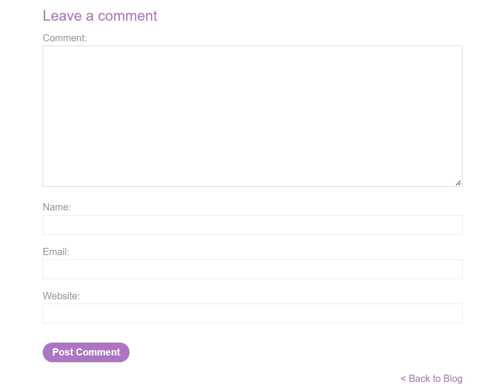

# XSS 2

---

## **Reflected XSS in a JavaScript URL with some characters blocked - Expert**

---

### Description:

This lab reflects your input in a JavaScript URL, but all is not as it seems. This initially seems like a trivial challenge; however, the application is blocking some characters in an attempt to prevent XSS attacks.

To solve the lab, perform a cross-site scripting attack that calls the `alert` function with the string `1337` contained somewhere in the `alert` message.

---

### PART I: Lab Enumeration

- The main page displays several blog posts. Each of them contains a comment section.
    
    
    
- However, my tests suggest that the comment sections are not vulnerable to XSS through this input because they are rendered as plain text rather than interpreted as HTML.
    
    
    
- The Website field uses a regex to validate input on the front end, so I can’t use the `javascript:alert()` payload from the previous lab.
    
    
    
- I try sending the input through a proxy to bypass front-end validation, but the back end appears to validate it as well.
    
    
    
- Looking at the page source again, I see that this anchor tag uses an `href` attribute with the `javascript:` scheme.
    
    
    
- And the `postId` value in the URL is reflected inside this `href` attribute. If I can inject into the `postId` value, I may be able to trigger XSS.
    
    
    
- Appending an arbitrary string to `postId` results in an “Invalid blog post ID” error because the server expects a number.
    
    
    
- So I add my own parameter using `&`. This keeps `postId` numeric while allowing me to inject an arbitrary string.
    
    
    
- This confirms that I can inject into the `href` attribute.
    
    
    
- Here is the injection point:
    
    ```html
    <a href="javascript:fetch('/analytics', {method:'post',body:'post?postId=<u>**INPUT_GOES_HERE**</u>'}).finally(_ => window.location = '/')">Back to Blog</a>
    ```
    
- The next step is to find a way to break out of the string and inject JavaScript while keeping the surrounding syntax valid.
- I first build a local demo and test the payload `&'+ alert(1) +'`. It successfully triggers an alert popup.
    
    
    
- However, when I try the same payload on the lab instance, the parentheses in `alert(1)` are removed and the space is replaced with `+`. This prevents me from calling a function directly using `()`.
    
    
    
- And this is where the lab solution payload comes into play.

---

### PART II: Payload Explanation

#### II.0: NOTE

- This lab is interesting because it is built on the research [[XSS without parentheses and semi-colons](https://portswigger.net/research/xss-without-parentheses-and-semi-colons)]. From this point on, I will focus on explaining the payload used in the solution.
- Payload:
    
    ```
    &%27},x=x=%3E{throw/**/onerror=alert,1337},toString=x,window%2b%27%27,{x:%27
    ```
    
- URL-decoded:
    
    ```
    5&'},x=x=>{throw/**/onerror=alert,1337},toString=x,window+'',{x:'
    ```
    

#### II.1: The Idea

- Calling a function normally requires `()`, but the filter blocks parentheses. So the goal becomes finding a way to invoke a function without using them.
- The solution payload achieves this by chaining two behaviors that JavaScript and the browser trigger automatically: assigning a function to `toString` allows it to run during implicit type coercion, while assigning `alert` to `onerror` causes the browser to invoke it when an uncaught exception occurs.
- The payload works as follows: I wrap the logic in an arrow function assigned to `x`, because `throw` cannot appear directly where the injection point expects an expression. Inside the function, the comma expression assigns `alert` to `onerror` and evaluates to `1337`, which `throw` then throws. I assign the function to `toString` and force string coercion with `window + ''`. This invokes the overwritten method, causing the function to throw an uncaught exception. The browser then invokes `onerror`, which now points to `alert`, producing an alert containing `1337`.
    
    
    

#### II.2: The Core Logic: `throw/**/onerror=alert,1337`

- The `throw` statement raises an exception using the value of the expression that follows it.
    
    
    
- When multiple expressions are separated by commas, JavaScript evaluates them from left to right. The comma operator returns the value of the last expression, so `throw` throws that value.
    
    
    
- Using this behavior, I assign `alert` to the `onerror` event handler. When the function throws `1337` and the exception remains uncaught, the browser invokes the handler, causing an alert containing `Uncaught 1337` to appear.
    
    
    
- Because spaces are replaced with `+`, using a regular space here would break the syntax. A block comment (`/**/`) can separate the tokens without introducing a space.
    
    
    

#### II.3: The Function Wrapping:`x=x=>{throw/**/onerror=alert,1337}`

- Failed approach:
    - The injection point is inside a string literal that provides the value of the `body` property in a JavaScript object literal.
        
        ```jsx
        {method:'post', body:'post?postId=INPUT_GOES_HERE'}
        ```
        
    - After breaking out of the string, I can inject JavaScript, but the injection point is still in a value position. A property value in an object literal must be an expression.
    - Because `throw` is a statement rather than an expression, placing it directly at this injection point causes a syntax error.
        
        
        
    - Therefore, I need to wrap the `throw` statement in a function, since a function expression can be used as a value.
- Solution approach:
    - This is the conventional way to define an arrow function with no parameters. The empty parentheses `()` are required before `=>`, and parentheses are also required to call the function.
        
        
        
    - Since the filter removes parentheses, I can’t use them to define or call the function directly.
        
        
        
    - However, JavaScript allows omitting the parentheses when an arrow function has exactly one parameter, even if the parameter is never used in the function body. The expression `x => { ... }` is equivalent to `(x) => { ... }`. In this payload, `x = x => { ... }` assigns the arrow function to the outer variable `x`.
        
        
        
    - I now have a valid function, but I still need a way to execute it without using parentheses.

#### II.4: The Trigger: `toString=x AND window+''`

- The `toString()` method can be invoked during string conversion. Here, I overwrite `window.toString` by assigning it the function stored in `x`.
- Now `toString` points to my function instead of the original method.
    
    
    
- I can’t call the function directly because parentheses are filtered. Instead, `window + ''` forces string coercion, which invokes the overwritten `toString` method. In a browser, `window` refers to the global object. When I concatenate it with an empty string, JavaScript converts it to a primitive value and invokes the overwritten `toString` method. This executes my function and triggers the alert.
    
    
    

#### II.5: The context

- If I insert `+` directly at this point in the string literal, the resulting JavaScript is syntactically invalid.
    
    
    
- Using a comma directly in this value position inside the object literal also causes a syntax error. In an object literal, commas separate properties; they do not act as the comma operator in this context.
    
    
    
- So I need to break out of the object literal and inject into the argument list of `fetch()`.
- Within the argument list of a function call (`fetch(a, b, c, d,...)`), the comma takes on a different meaning: it serves as a separator for arguments. Each argument can be an independent assignment expression.
- This `fetch()` call uses two arguments.
    
    ```jsx
    ...fetch('/analytics', {method:'post',body:'post?postId=INPUT_GOES_HERE'})...
    ```
    
- The same behavior can be demonstrated with this simple function.
    
    
    
- When I pass more arguments than the function uses, its return value remains unchanged and no error is thrown.
    
    
    
- The key is that JavaScript still evaluates those extra argument expressions before calling the function, even if the function does not use them.
    
    
    
- (You can actually write it like this to trigger the popup.)
    
    
    
- Applying this to the solution payload gives the final version:
    
    ```html
    <a href="javascript:fetch('/analytics', {method:'post',body:'post?postId=2&'},x=x=>{throw/**/onerror=alert,1337},toString=x,window+'',{x:''}).finally(_ => window.location = '/')">Back to Blog</a>
    ```
    
- Because the original payload leaves a trailing `'}` .
    
    ```jsx
    ...,window+'''}.finally...
    ```
    
- `,{x:'` is added to restore the intended JavaScript syntax.
    
    ```jsx
    ...,window+'',{x:''}.finally...
    ```
    

---

### PART III: Exploitation

- Selecting a post and pasting the payload immediately solves the lab.
    
    
    

---

### PART IV: Root Cause & Remediation

#### Root Cause

- The application relies on a character-level blacklist that removes or replaces specific characters (`(`, `)`, and spaces) in the reflected input before inserting it into a dynamically constructed `javascript:` URL. Like any blacklist, it can only block patterns its author anticipated. It cannot account for every alternative way JavaScript can express the same behavior.
- Blocking the `(` and `)` characters prevents conventional function-call syntax, but it does not prevent code execution through mechanisms that invoke functions indirectly — such as implicit type coercion invoking an object's `toString()` method, or the browser calling `window.onerror` when an uncaught exception occurs. These mechanisms do not depend on the attacker being able to write a conventional function call, so blocking these characters alone does not eliminate the underlying XSS vulnerability.
- The payload also exploits JavaScript's context-specific grammar. The comma operator allows multiple expressions to be evaluated in sequence, while the existing argument list of `fetch(...)` provides a context where additional comma-separated expressions can be inserted and evaluated. Because the opening parenthesis belongs to the application's original source code, the attacker can reuse the existing call structure without injecting a new `(` character.
- The fundamental architectural issue is that user input is concatenated directly into a string that is later parsed and executed as JavaScript through a `javascript:` URL. This makes the application vulnerable to XSS because the input can alter the surrounding code rather than remain data. Character-level filtering cannot reliably secure this execution context, as alternative syntax and indirect function invocation can bypass specific character restrictions.

#### Remediation

- Never construct executable JavaScript by concatenating user-controlled input into a string that is later parsed as code, including `javascript:` URLs built from request parameters. Like `eval()`, this design allows untrusted input to influence code execution and cannot be made reliably safe through character-level filtering.
- Remove the dynamic `javascript:` URL entirely. Perform the tracking or analytics request through a static event handler, such as an attached `click` listener in a separate script file. Obtain `postId` from a trusted application state or validate it against the expected format before using it in the request.
- Deploy a restrictive Content Security Policy (CSP) that blocks `javascript:` URLs and unauthorized inline script execution. This can provide an additional layer of defense against this exploitation path, but it should not replace removing the unsafe URL construction.
- Avoid embedding user-controlled input in executable JavaScript whenever possible. If dynamic data must be included in a JavaScript string, use a well-tested, context-appropriate encoding mechanism that handles all relevant characters and syntax boundaries. Do not rely on an ad hoc character blacklist to prevent XSS.
