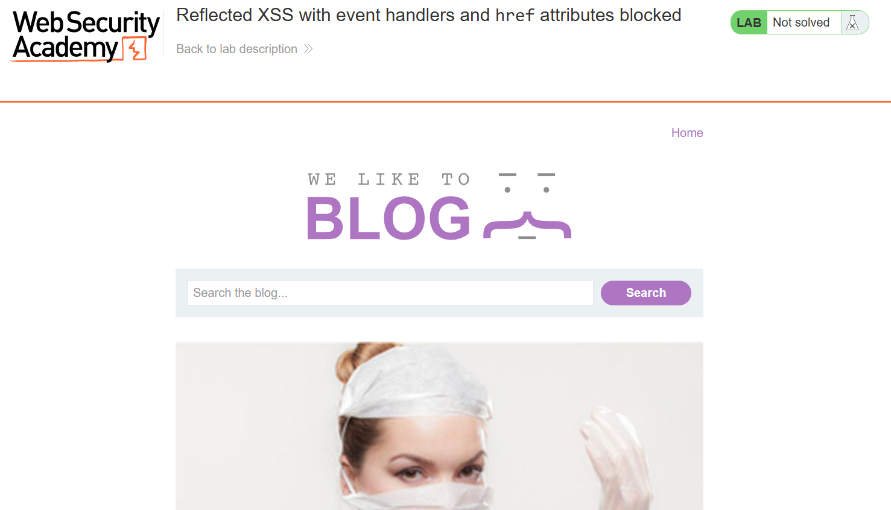

# XSS 1

---

### **Reflected XSS with event handlers and `href` attributes blocked - Expert**

---

#### Description:

This lab contains a reflected XSS vulnerability with some whitelisted tags, but all events and anchor `href` attributes are blocked.

To solve the lab, perform a cross-site scripting attack that injects a vector that, when clicked, calls the `alert` function.

Note that you need to label your vector with the word "Click" in order to induce the simulated lab user to click your vector. For example:

```
<a href="">Click me</a>
```

---

#### PART I: Lab Enumeration

- The main page of the lab contains only one function, which is `Search` .
    
    
    
- I search for a random string and see that it is reflected in the page.
    
    
    
- I checked the page source but didn’t see any script. Since the input is reflected in the page, I want to see how the application processes it.

---

#### PART II: Behavior Identification

- The random string is placed inside an `<h1>` tag.
    
    
    
- And when I try injecting a tag, the application blocks it and displays “Tag is not allowed”. This suggests that the application may use a blacklist to block certain tags.
    
    
    
- So I use this cheat sheet to test which tags are allowed by the application.
    
    
    
- The result shows that the application allows some tags.
    
    
    
- Since the lab requires the vector to contain the word “Click” so that the simulated user will click it, I pay attention to the hint: `<a href="">Click me</a>`.
- So I follow the hint and start by creating a “Click me” link.
- Current payload:
    
    ```html
    <a>Click me</a>
    ```
    
- The payload is rendered, confirming that the `<a>` tag is allowed by the filter.
    
    
    
- However, the filter blocks the event handlers and tags that can execute JavaScript. `href` is the only choice left in this case.
- Current payload:
    
    ```html
    <a href=javascript:alert(1)>Click me</a>
    ```
    
- But the filter blocks the `href` attribute as well.
    
    
    
- So let’s see what I can do with the remaining tags.

---

#### PART III: Research & Exploitation

- I look into the `<svg>` and `<animate>` elements.
    
    
    
- The documentation provides the following example:
    
    
    
- In the example above, the `<animate>` element changes the `rx` attribute of its parent `<rect>`, which controls the horizontal radius of its rounded corners. The `values` attribute defines the sequence `0 → 5 → 0`, making the rectangle transition from sharp corners to rounded corners and back. The animation lasts 10 seconds per cycle and repeats indefinitely.
- In other words, the `<animate>` element allows me to change an attribute of its target element at runtime.
- In the anchor tag above, I haven't set an `href` attribute. I start thinking about whether I can use `<animate>` to set it later. Since the filter blocks a literal `href` attribute in the input, I want to see whether I can use `<animate>` to set its value to an XSS payload at runtime.
- For example, I want to change the `href` attribute of the anchor. So I place `<animate>` inside the `<a>` element, like this:
    
    ```html
    <a><animate.../>Click me</a>
    ```
    
- Since `<animate>` is an SVG element, I first need to place the anchor inside an `<svg>` element.
    
    ```html
    <svg><a>Click me</a></svg>
    ```
    
- The SVG is rendered, but the link text is not visible.
    
    
    
- Because in SVG, text content needs to be placed inside a `<text>` element to be rendered as visible text.
    
    
    
- So to make it visible, I will wrap the “Click me” within `<text>` element.
    - `x and y` : specify the position of the displayed text within the SVG coordinate system.
- Current payload:
    
    ```html
    <svg><a><text x="20" y="20">Click me</text></a></svg>
    ```
    
- Now the text is visible again, but the position looks weird. Never mind.
    
    
    
- The last step is to use `<animate>` to set the `href` attribute of the anchor.
    - `attributeName`: specifies which attribute to animate.
    - `values`: specifies the sequence of values to apply to that attribute.
- Current payload:
    
    ```html
    <svg><a><animate attributeName="href" values="javascript:alert(1)"/><text x="20" y="20">Click me</text></a></svg>
    ```
    
- Submitting the payload immediately solves the lab. (You can click “Click me” to trigger the alert if you want).
- Note that the string `href` still appears in the payload, but as the value of the `attributeName` attribute rather than as an attribute name itself. The filter blocks `href` when it appears as an actual attribute name, but does not recognize it in this context.
    
    
    

---

#### PART IV: Root Cause & Remediation

- **Root Cause**
    - The application uses a blacklist to reject disallowed tags, attribute names, and event handlers by matching patterns in the submitted input. This filter does not prevent the browser from creating a dangerous state through an allowed element such as SVG animation.
    - The filter blocks `href` when it appears as an attribute name, but does not recognize `attributeName="href"` inside `<animate>` as a way to modify that attribute. The browser's SVG animation engine can then set the target element's `href` after the input has passed the filter.
    - This demonstrates why blacklisting dangerous strings is not a reliable way to prevent XSS. An allowed browser feature may still create a dangerous state indirectly, even when the corresponding syntax is blocked in the original input.
- **Remediation**
    - Use context-aware output encoding when rendering untrusted input, rather than relying on a blacklist. Encode the input appropriately for the HTML context in which it is inserted.
    - Deploy a strict Content Security Policy (CSP) as an additional layer of defense against script execution. Configure and test the policy to ensure that it blocks the execution paths used by this payload.
    - If the application needs to allow only a limited set of HTML elements, use an allowlist-based sanitizer and exclude SVG animation elements unless they are explicitly required and safely supported.
    - Use a maintained allowlist-based HTML sanitizer, such as DOMPurify, instead of a custom blacklist. Keep the sanitizer updated and configure its allowed tags and attributes to match the application's requirements.
